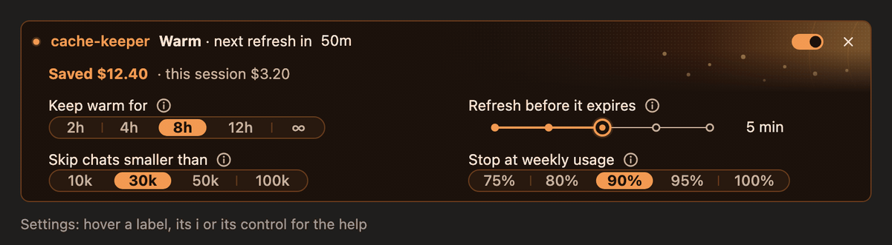

# cache-keeper

**Stop paying full price every time you come back to a long Claude Code chat.**

cache-keeper keeps your chat's memory warm while you're away, with one tiny refresh before it expires.




## Why you'd want this

**The problem**

- Claude keeps your chat in a memory called the **cache**. Reusing it is very cheap.
- In the Claude Code app and CLI (Pro and Max plans), that memory is wiped after **1 hour** without a message.
- After that, your next message sends the **whole chat again**, at more than full price.

**When it bites**

- **You step away.** A meeting, lunch, or you just forget to reply for an hour.
- **Long background tasks.** Claude starts a build, a test run or some agents that take over an hour. The main chat sits idle. When the task finishes, the whole chat is sent again.

**The prices** (from Anthropic's [pricing](https://platform.claude.com/docs/en/about-claude/pricing) and [prompt caching](https://platform.claude.com/docs/en/build-with-claude/prompt-caching) pages, per 1 million tokens)

| | Opus 5.5 | Sonnet 5.5 |
|---|---|---|
| Normal input | $4 | $2 |
| Rebuilding the memory (1-hour cache) | **$8** | **$4** |
| Reading a warm memory | **$0.20** | **$0.10** |

👉 **Rebuilding costs 40× more than reading.**

**What cache-keeper does**

- A little before the hour runs out, it sends one tiny "keep this alive" request.
- That costs about one warm read: a few cents.
- Your memory stays warm. Your next message is cheap.

## How much it saves

Examples use a 50/50 mix of Opus 5.5 and Sonnet 5.5, at list prices.

**One break: a 600k-token chat, you're away 3 hours**

| | Without | With cache-keeper |
|---|---|---|
| What happens | the whole chat is rebuilt | 3 tiny refreshes |
| Cost | **$3.60** | **$0.27** |

**A heavy day: the memory would expire 4 times, about 2 hours each, on a 600k chat**

| | Without | With cache-keeper |
|---|---|---|
| Per day | $14.40 | ~$0.72 |
| Per month (22 workdays) | **~$317** | **~$16** |

On a 700k chat: about **$4.20** per rebuild against about **$0.11** per refresh.

On a Pro or Max plan you don't pay these dollars directly. But the same rebuild eats into your **usage limits**, often a few percent of your week in one message.

## Who it's for

- ✅ Claude Code **desktop app or CLI** users with long chats (100k+ tokens).
- ✅ People who take breaks, or run long background tasks.
- ⚠️ **API keys:** the memory lasts only 5 minutes there. cache-keeper keeps it warm only while Claude is working, not while you're idle. (There's an option to switch to the 1-hour cache.)
- ❌ Not needed for short chats, or if you always reply within the hour.

## Install

In Claude Code:

```
/plugin install cache-keeper --marketplace parab-aditya/cache-keeper
```

Or from a shell:

```
claude plugin install cache-keeper --marketplace parab-aditya/cache-keeper
```

Then start a new session.

**Desktop app:** `+` next to the prompt → Plugins → Add plugin → cache-keeper (add `parab-aditya/cache-keeper` as a marketplace first if it isn't listed).

**Update:** `claude plugin marketplace update heycache && claude plugin update cache-keeper@heycache`, then a new session.

**Uninstall:** `claude plugin uninstall cache-keeper@heycache`, then `claude plugin marketplace remove heycache`.

**For a team:** add this to the project's `.claude/settings.json`:

```json
{
  "extraKnownMarketplaces": {
    "heycache": { "source": { "source": "github", "repo": "parab-aditya/cache-keeper" } }
  },
  "enabledPlugins": { "cache-keeper@heycache": true }
}
```

Needs Claude Code 2.1.287+ in a terminal, or the desktop app 2.1.286+. Not in WSL or cloud sessions.

## How to use it

1. **It's off by default.** Every new session starts off, so it never spends anything unless you turn it on.
2. **Turn it on** with the switch on the band, or `/cache on`.
3. **Pick how long** to keep it warm with the chip: 2h, 4h, 8h (default), 12h or ∞.
4. **That's it.** It refreshes until that time has passed since your last message, then stops.

**The band** above the prompt shows what's happening:

| State | Meaning |
|---|---|
| 🔥 warm | memory is kept warm; shows the next refresh |
| ✨ refreshing | a refresh is being sent |
| ⏸ off | warming is off for this session |
| 🟠 cooling | off or finished, and the memory expires within 10 minutes |
| ❄️ cold | memory expired; shows what your next message will cost |
| ⏹ stopped | it stopped, and says why |

The **gear** opens settings. Hover any setting to see what it does.

The terminal gets one quiet line with small buttons: `k` keep, `o` on/off, `s` settings.

### Forgot a session was warming?

- A small 🔥 with a number on the band means **other sessions** are warming too. Press it to see them.
- Each one shows its sidebar name, how long it's been idle and what it has cost. Press **Stop** on any of them.
- A session you **archive or delete** stops warming on its own.

### Commands

| Command | What it does |
|---|---|
| `/cache` | status |
| `/cache on` / `off` | turn warming on or off for this session |
| `/cache keep 2h` | keep warm for 2h, 4h, 8h, 12h or `forever` (add `--save` to make it your default) |
| `/cache stats` | what it spent and what it saved: this session and all time |
| `/cache sessions` | your other sessions that are warming |
| `/cache stop 2` / `stop all` | stop one of them, or all |
| `/cache settings` | open settings |
| `/cache refresh-now` | refresh right now |
| `/cache debug` | details, for troubleshooting |

### Settings

Change them in the settings sheet, or with `/config` (rows named `cache-keeper.*`).

| Setting | Default | What it does |
|---|---|---|
| Keep warm for | 8h | how long after your last message it keeps warming, once you turn it on |
| Refresh before it expires | 5 min | how early it refreshes before the hour is up |
| Skip chats smaller than | 30k tokens | small chats are cheap to rebuild, so they're skipped |
| Stop at weekly usage | 90% | stops warming when your weekly plan usage hits this |
| Band | full | full, minimal (one line) or off |
| 1-hour cache for API keys | off | switch API-key sessions to the 1-hour cache |

## Good to know

- **Background tasks** still running keep it warming for up to 24 hours, so Claude finds a warm memory when the task wakes it.
- **It stops on its own** when the time runs out, at your weekly limit, on a rate limit or error, or when the chat is compacted, cleared or switches model.
- **A sleeping Mac misses refreshes.** The band tells you when that happens. There's no keep-awake.
- **One refresh** is one cheap read plus about 4 output tokens. We measured about **$0.08** on a 400k Opus chat.
- **All dollar figures are estimates** at list prices.

## What it touches

- **Sends:** only the refresh requests, to the same model your session uses. A refresh adds one hidden line asking Claude to reply "ok". The reply is thrown away, no tools can run, and nothing is added to your chat.
- **Adds to your chat:** one dim note when warming stops (Claude never sees it).
- **Reads:** your session's token usage, plan limits and cache settings; the theme; whether the session uses a plan or an API key (never the key itself); and when background tasks run or Claude is asking you something. To match light and dark, the desktop app's appearance setting, or macOS's (`defaults read -g AppleInterfaceStyle`). On the desktop, your session's own record in the app (`~/Library/Application Support/Claude*/claude-code-sessions/`): its title and whether it's archived.
- **Writes, all on your machine:**
  - a small log per session in `~/.claude/cache-keeper/` (numbers only, never your chat);
  - one status file per session in `~/.claude/cache-keeper/live/`, which your other sessions read to show who's warming (a Stop writes a small `.stop.json` there);
  - totals and saved settings in the plugin's own store.
- **Sets** `CLAUDE_CODE_PROMPT_CACHE_TTL=1h` only if you turn on the 1-hour option, and unsets it when you turn it off.

Delete `~/.claude/cache-keeper/` to remove all its files.

## Development

Run from another folder (for example `cd /tmp`):

```
claude plugin validate <path-to-this-folder>
claude plugin test <path-to-this-folder>
```

`npx -y tsx tools/preview.ts` draws every state into `docs/preview.html`. `node tools/record-gifs.mjs` records the GIFs (needs ffmpeg).

## Credits and licence

- The refresh technique and test setup are adapted from [claude-code-cache-warmer](https://github.com/paulbkim-dev/claude-code-cache-warmer) by Paul B. Kim (MIT).
- The band's look and controls are adapted from [effortless](https://github.com/HeyCubit/effortless) by HeyCubit (MIT).

Licence texts: [THIRD_PARTY.md](THIRD_PARTY.md). cache-keeper is MIT-licensed: [LICENSE](LICENSE).
