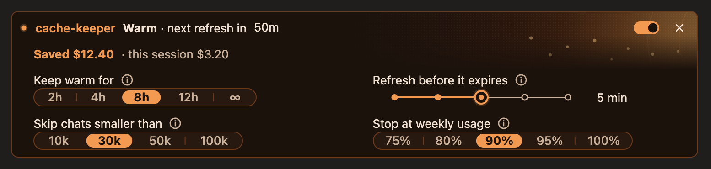
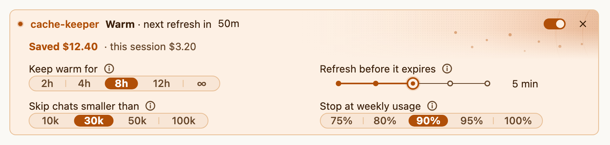

# cache-keeper

A Claude Code mod that keeps a chat's prompt cache warm while you are away, and shows its state in a band above the prompt.

Claude Code caches your conversation so each new message only pays a small "cache read" for the old part. The cache expires after an idle period: 1 hour on Pro and Max plans, 5 minutes on API keys. Leave a chat for a lunch break or overnight (a question waiting for your answer, a long background job) and your next message writes the whole conversation into the cache again at full price. On a long chat that one message can cost a few percent of a weekly limit. cache-keeper sends a tiny refresh shortly before the cache would expire, for as long as you choose (8 hours by default), so the next message is a cheap read again. It adds nothing to the conversation.

| Warm, dark | Warm, light |
|---|---|
|  |  |

The gear opens the settings sheet (shown with sample figures):

| Settings, dark | Settings, light |
|---|---|
|  |  |

## Requirements

- Claude Code in a terminal 2.1.287 or newer, or the Claude desktop app 2.1.286 or newer (mods are on by default from those versions). Built and tested on 2.1.295 and 2.1.296. There is no minimum-version field in a plugin, so this is the floor to check yourself.
- macOS, Linux or Windows in a terminal, or the desktop app's Code tab. Not in WSL sessions or cloud sessions.
- Organisations that allow only managed mods (`allowManagedModsOnly`) block mods from a marketplace.
- The band's art and the settings sheet are drawn in the desktop app only. The terminal gets one quiet line with small buttons (`k` keep, `o` on/off, `s` settings); `/cache settings` opens a settings pane there when the window has room.

## Install

In a Claude Code session (terminal 2.1.275 or newer), one line:

```
/plugin install cache-keeper --marketplace parab-aditya/cache-keeper
```

Answer `y` to add the marketplace, pick a scope (user is the first), and set the options if you want to. Or in two steps:

```
/plugin marketplace add parab-aditya/cache-keeper
/plugin install cache-keeper@heycache
```

From a shell (terminal 2.1.292 or newer, one line; the user scope is the default):

```
claude plugin install cache-keeper --marketplace parab-aditya/cache-keeper
```

or in two steps:

```
claude plugin marketplace add parab-aditya/cache-keeper
claude plugin install cache-keeper@heycache
```

If it says options are not set, that is fine: the defaults below apply. Change them with `/config` or `/plugin configure cache-keeper@heycache`.

In the desktop app: click `+` next to the prompt, then Plugins, then Add plugin, and pick cache-keeper from the marketplace list (add `parab-aditya/cache-keeper` as a marketplace first if it is not listed). A plugin installed at user scope from a terminal also loads in the desktop app's local sessions. Then start a new session.

**Update.** The version in `plugin.json` has to change for an update to install:

```
claude plugin marketplace update heycache
claude plugin update cache-keeper@heycache
```

Then run `/reload-plugins` or start a new session (the desktop app loads an update only in a new session). Auto-update is off by default for third-party marketplaces; turn it on under `/plugin`, Marketplaces, Enable auto-update.

**Uninstall.**

```
claude plugin uninstall cache-keeper@heycache
claude plugin marketplace remove heycache
```

Run the second line only when nothing else from heycache is installed. The per-session logs are in `~/.claude/cache-keeper/`; delete that folder to remove them.

**For a team.** Put this in the project's `.claude/settings.json` and everyone who trusts the folder is offered the plugin:

```json
{
  "extraKnownMarketplaces": {
    "heycache": { "source": { "source": "github", "repo": "parab-aditya/cache-keeper" } }
  },
  "enabledPlugins": { "cache-keeper@heycache": true }
}
```

## Using it

Nothing to do: it starts when the first request of a chat has been made, and refreshes until the keep-warm window (counted from your last message) ends.

**The band** has one line and a few controls.

| State | Meaning |
|---|---|
| warm | cache is kept; shows when the next refresh is due (and "waiting on your answer" or "N background tasks" when that is why you are away) |
| refreshing | a refresh is running (a failed one shows "retrying in ...") |
| off | auto-refresh is off for this session; the cache still has some time left |
| cooling | off, finished or stopped, and the cache expires in 10 minutes or less (a third of the lifetime on the 5-minute cache): the colour turns to an alert |
| cold | the cache has expired; shows what your next message will rewrite: tokens, an estimated cost, and the share of your 5-hour limit once the mod has learned it |
| stopped | warming stopped, with the reason (weekly guard, rate limit, API error, a refresh missed while the Mac slept, the prompt changed, model switched, conversation compacted or cleared). A finished window reads "Kept warm for 8h" |

It also says so when a chat is too small to bother with ("not kept warm") and when you are on the 5-minute cache and nothing is running.

Controls (desktop): the switch turns auto-refresh on and off for this session; the chip shows the window (`2h`, `4h`, `8h`, `12h` or `∞`) and cycles through them when pressed; the gear opens the settings sheet. Hover the line to see when the cache expires. In the sheet, **Save as default** writes your session's choices to the `/config` rows.

**`/cache`** (bare `/cache` is `status`):

| Command | What it does |
|---|---|
| `/cache status` | the band line plus the details: cache lifetime and why, last request, expiry, next refresh, window, background tasks, limits, last refresh |
| `/cache on` | warm again, for the window it had before `off` (else the saved window, 8h unless you changed it) |
| `/cache off` | stop auto-refresh for this session (`pause` and `resume` do the same as off and on) |
| `/cache keep <2h\|4h\|8h\|12h\|forever> [--save]` | the window for this session; `--save` also makes it the default |
| `/cache lead <2-15> [--save]` | refresh this many minutes before the 1-hour cache expires (the 5-minute cache is refreshed 30 seconds before). `--save` only takes 2, 3, 5, 10 or 15 |
| `/cache refresh-now` | refresh at once, if the usual guards allow it |
| `/cache stats` | refreshes made, what they cost, rewrites avoided and what that saved: this session and all time |
| `/cache settings` | open the settings (the sheet on the desktop band, else a pane) |
| `/cache debug` | state dump and the last lines of this session's log |

**Settings** are `/config` rows named `cache-keeper.*`, or `/plugin configure cache-keeper@heycache`:

| Row | Options | Default |
|---|---|---|
| `keepFor`: keep the cache warm for | off, 2h, 4h, 8h, 12h, forever | 8h |
| `lead`: refresh this many minutes before expiry | 2, 3, 5, 10, 15 | 5 |
| `minTokens`: skip contexts smaller than | 10000, 30000, 50000, 100000 | 30000 |
| `weeklyGuard`: stop at weekly usage % | 50, 75, 80, 90, 95, 100 | 90 |
| `band`: band above the prompt | full, minimal, off | full |
| `upgradeTo1h`: use the 1-hour cache on API-key sessions | off, on | off |

Background tasks (a long shell command, a monitor, a sub-agent) that are still running stretch the window to 24 hours from your last message, so a task that wakes Claude finds a warm cache. On the 5-minute cache, refreshing an idle chat every 4.5 minutes barely pays, so it is refreshed only while Claude is working, for up to an hour; turn on `upgradeTo1h` to move such a session to the 1-hour cache (the first message after that writes the cache once, at the higher 1-hour price).

## What it costs

One refresh is one cached read of the conversation plus a few output tokens. Measured on Claude Code 2.1.295 with Opus 5.5: a single request, about 4 output tokens, and about $0.08 for a 400k-token conversation, around 1/40 of what rewriting that cache costs (on models whose cache read is a tenth of the input price, about 1/20). Refreshes count toward your plan usage at about that read price. Two settings limit them: the weekly guard stops warming when your weekly plan usage reaches the percent you set (when your plan reports one), and the small-chat skip leaves contexts under 30k tokens alone. `/cache stats` shows what you spent and what you saved. Dollar figures are estimates at API list prices; on a Pro or Max plan they are usage, not billing.

## What it touches

- **Reads:** the session's token usage and plan limits; the session's settings (`promptCacheTtl`) and three environment variables (`FORCE_PROMPT_CACHING_5M`, `CLAUDE_CODE_PROMPT_CACHE_TTL`, `ENABLE_PROMPT_CACHING_1H`) to know the cache lifetime; the `theme` setting; main-thread tool calls and their results, permission prompts and background-task notifications, to know when a background task is running or you are being asked something (the first 80 characters of a background command or description are kept in session state for `/cache status` and `/cache debug`, never logged); and whether the session uses a plan or an API key (the kind only, never the key or token). When the theme is `auto` it reads the Claude desktop app's appearance (`~/Library/Application Support/Claude/config.json`, the `userThemeMode` key only) and, if that does not say, runs `defaults read -g AppleInterfaceStyle` on macOS, to match light and dark. In a terminal it assumes dark and reads neither, except possibly once at session start, before it knows it is in a terminal.
- **Writes:** one log file per session, `~/.claude/cache-keeper/<session-id>.jsonl` (capped at about 2 MB): token counts, cost, result and reason of each refresh, never conversation text. Totals, learned rates and saved defaults in the plugin's own store. The plugin's own `cache-keeper.*` config rows when you press Save as default. It may set `CLAUDE_CODE_PROMPT_CACHE_TTL=1h` for its own process and the commands it starts afterwards (a nested `claude` included), only when `upgradeTo1h` is on; turning that option off unsets it again.
- **Sends:** nothing anywhere except the refresh requests, which go to the same model the session uses. A refresh re-sends the conversation (read from the cache) with one extra message: "[cache-keeper] Automated prompt-cache refresh from the cache-keeper plugin, not a message from the user. ... Reply with only the word: ok". The reply is discarded. The refresh runs with every tool denied and is not added to the conversation.
- **Adds to the conversation:** one dim notice row when warming stops (not sent to the model), for example "cache-keeper · kept warm 7h52m · 9 refreshes · $0.72 · stopped: ...".

## Limits

- A sleeping Mac misses refreshes. The band then says "refresh missed while asleep" and when the cache went cold. There is no keep-awake.
- `/compact`, `/clear`, a model switch, a change to the MCP tool list or a Claude Code upgrade reset the cache whatever this mod does; it stops warming and starts again with your next message. A refresh that finds the cache already cold stops too.
- The desktop app loads a plugin update only in a new session.
- Dollar and percent figures are estimates.

## Development

From another directory (for example `cd /tmp`), because the commands read the current folder as a project:

```
claude plugin validate <path-to-this-folder>
claude plugin test <path-to-this-folder>
```

`npx -y tsx tools/preview.ts` writes `docs/preview.html`, a page that draws the band and the settings sheet in every state from the real modules.

## Credits and licence

- The refresh technique (`$.model.fork`), the anchor and outcome rules, and the test world are adapted from [claude-code-cache-warmer](https://github.com/paulbkim-dev/claude-code-cache-warmer) by Paul B. Kim (MIT).
- The band's structure, the drawn controls, the art techniques and the saved-defaults pattern are adapted from [effortless](https://github.com/HeyCubit/effortless) by HeyCubit (MIT).

Both licence texts are in [THIRD_PARTY.md](THIRD_PARTY.md). cache-keeper is MIT-licensed, see [LICENSE](LICENSE).
